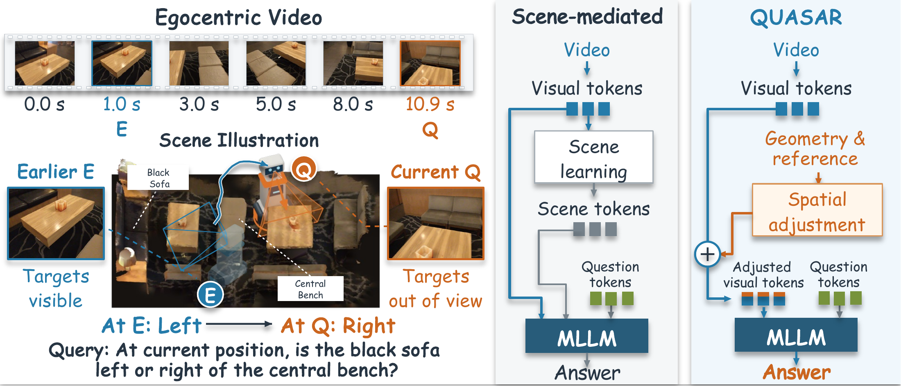
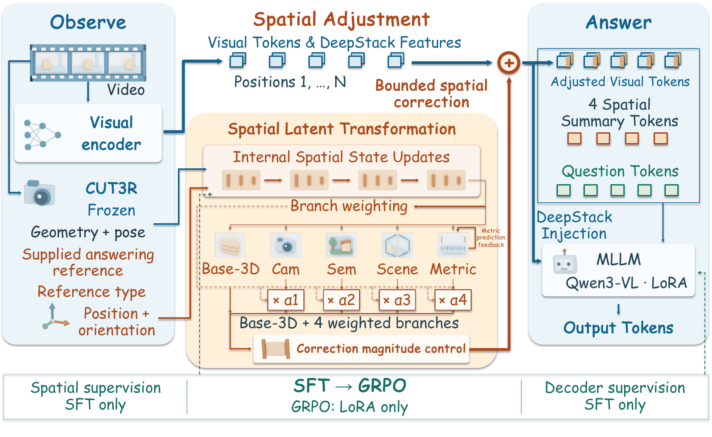

# QUASAR: Query-Framed Spatial Reasoning via Spatial Latent Transformation in Video MLLMs

QUASAR helps a video language model answer spatial questions from a viewpoint that the camera may never have occupied. It keeps the model's own visual features and adds a small, bounded spatial correction computed from estimated scene geometry and a supplied answering reference.



**Past evidence, current reference.** At pose E the robot sees the black sofa to the left of the bench. At its current pose Q both objects are out of view, yet the question asks about them from Q, where the sofa is on the right. The earlier observation is still useful, but its left/right relation cannot simply be reused. Instead of first learning a separate scene representation (middle), QUASAR adds a correction to the original visual tokens using geometry and the supplied reference, and the MLLM answers the full question from the adjusted evidence (right).

## Abstract

Answering spatial questions from video requires combining observations made at different positions and viewing directions. Remembering what was seen is not enough when a question asks for a relation from another viewpoint. Each frame records evidence at an *observation pose*, the camera's position and orientation at that moment. A question may require a different *answering reference*: where to stand and which way to face when judging the relation. Counts, sizes and distances, by contrast, should stay the same whichever way one looks.

QUASAR (QUery-frAmed SpAtial Reasoning) studies a direct way to bridge this gap. Given geometry estimated from the video and an explicit reference type and numerical pose, its Spatial Latent Transformation computes a bounded correction for every visual position and adds it to the original visual features. The MLLM then reads these features together with the full question and generates the answer; it does not first decode a separate scene representation. Spatial supervision, including four learned spatial summary tokens, is used during supervised fine-tuning (SFT), followed by Group Relative Policy Optimization (GRPO).

With Qwen3-VL-8B, QUASAR reaches 65.36 on VSI-Bench and 66.19 on VSTI-Bench in the paper, 1.75 and 3.93 points above the Visual-only baseline (SFT+GRPO). Interventions on fixed models support that the answers use the visual corrections and, for target-camera questions with a parsable frame, the numerical reference.

## Method overview



1. **Observe.** The Qwen3-VL visual encoder turns up to 32 video frames into visual tokens. A frozen CUT3R model estimates a 3D point, confidence and camera pose for every visual position. This geometry is needed at inference time as well as in training.
2. **Supply a reference.** The reference is supplied as an extra input, built from the viewpoint the question states and the geometry estimated from the video; it carries no answer information. Supplying it lets us study one question in isolation: once the reference is given, how does it enter the MLLM and change the answer?
3. **Adjust the evidence.** Spatial Latent Transformation updates a spatial state at each visual position in four learned steps, conditioned on the reference. Five branches (base 3D, target camera, semantic anchor, scene canonical and metric scale) are mixed into one correction. Its size is capped at 15% of the native feature norm, and it is added to both the visual tokens and the aligned DeepStack features. The correction is a learned feature update, not an exact rigid transformation of the scene.
4. **Answer.** The MLLM reads the adjusted visual tokens, four spatial summary tokens and the full question, and generates the answer.

During SFT, auxiliary losses on the spatial module and on decoder states predict reference pose, bird's-eye-view occupancy, local coordinates and metric quantities. GRPO then updates only the LoRA adapters and keeps the spatial path fixed. At inference the model needs the geometry, the reference and the trained spatial module, including its metric feedback; it does not need the decoder-side auxiliary predictions or any auxiliary loss.

## Main results

Paper-reported task macro-averages for the five model roles released or evaluated here, all built on Qwen3-VL-8B-Instruct. VSI-Bench uses 5,130 questions over eight tasks. VSTI-Bench is the historical release with 6,042 questions over five tasks.

| Model | Weights | VSI-Bench | VSTI-Bench |
| --- | --- | ---: | ---: |
| Base (Qwen3-VL-8B-Instruct) | official | 59.82 | 46.31 |
| Visual-only (SFT) | W06 | 62.79 | 61.86 |
| Visual-only (SFT+GRPO) | W05 | 63.62 | 62.26 |
| QUASAR (SFT) | W02 | 64.86 | 65.11 |
| **QUASAR (SFT+GRPO)** | **W01** | **65.36** | **66.19** |

Visual-only shares the backbone, training data and GRPO budget but has no geometry input, spatial module or summary tokens. 
Per-task scores, literature rows and ablations are in the [experiment index](docs/EXPERIMENT_INDEX.md) and the [main-table contract](docs/TABLE12.md).

**Independent re-run.** We independently re-ran seven evaluation settings, generating 40,470 answers. Five settings reproduced the original answers exactly, question by question.

## What is in this repository

| Path | Contents |
| --- | --- |
| `src/quasar/` | Model, training (SFT, GRPO), generation, input preparation and scoring code |
| `configs/` | Saved training and evaluation recipes, path template and main-table profiles |
| `data/` | Training/validation QA with per-source licenses, member lists and data guides |
| `checkpoints/` | Weight index and loading guide (weights are downloaded separately) |
| `experiments/` | Original answers and scores for the paper's experiment groups |
| `docs/` | Environment, input construction, evaluation protocol and release scope |
| `scripts/`, `tests/` | Command helpers, CUT3R build helper and CPU tests |

Videos, computed geometry and features, the Qwen backbone and the project weights are not stored in the source.

## Quick start

### 1. Install

Tested on Linux x86_64 with Python 3.10, CUDA 12.8, FFmpeg/FFprobe and one A100 80GB. Details are in the [environment guide](docs/ENVIRONMENT.md).

```bash
python3.10 -m venv .venv
. .venv/bin/activate
python -m pip install torch==2.10.0 torchvision==0.25.0 --index-url https://download.pytorch.org/whl/cu128
python -m pip install 'transformers @ https://github.com/huggingface/transformers/archive/16a5b0936dcaae6efbc03ab1a4fd98dc324bfb9e.zip'
python -m pip install '.[test]'
python -m pip check
HF_HUB_OFFLINE=1 TRANSFORMERS_OFFLINE=1 python -m pytest tests -c pyproject.toml --rootdir=. -q
```

Base and Visual-only only need RGB frames. QUASAR also needs CUT3R; follow the [CUT3R installation](docs/ENVIRONMENT.md#cut3r-reconstruction-component) before running a QUASAR model.

### 2. Get benchmarks, backbone and weights

- **Benchmarks:** [main-table downloads](data/TABLE12_DOWNLOADS.md) gives pinned revisions, commands and folder layouts for VSI-Bench and historical VSTI-Bench. VSTI questions and videos are not redistributed here; download them from the provider and follow its terms.
- **Backbone:** official `Qwen/Qwen3-VL-8B-Instruct` at revision `0c351dd01ed87e9c1b53cbc748cba10e6187ff3b` ([command](data/TABLE12_DOWNLOADS.md#official-backbone)).
- **Project weights:** W01, W02, W05 and W06 contain only the parameters added by this project (LoRA, plus the spatial module for QUASAR) and are loaded on top of the official backbone. Download links: `TOBEADD`. The [checkpoint guide](checkpoints/README.md) lists the files and explains extraction and loading.
- **Training and scoring QA:** Training QA is downloaded separately (`TOBEADD`); validation and historical Base VSI scoring records are included. The [data file list](data/DOWNLOAD_GUIDE.md#included-records-and-additional-inputs) gives filenames, download links and expected locations.

Training data is not needed for evaluation.

### 3. Set paths once

```bash
cp configs/reviewer_paths.example.json reviewer_paths.json
```

Edit the source, output, backbone, benchmark, weight and CUT3R paths. Relative paths are resolved from the JSON file's folder. Keep all keys; paths for datasets or models you do not run need not exist.

### 4. Check and run a small example

```bash
quasar-reviewer --paths reviewer_paths.json --stage check
quasar-reviewer --paths reviewer_paths.json --stage prepare --dataset vsti --role quasar_grpo --smoke
quasar-reviewer --paths reviewer_paths.json --dataset vsti --role quasar_grpo --smoke
```

`--smoke` runs a few fixed questions to test the input route; it does not produce a table score. Preparation extracts the registered frames, runs CUT3R when needed, builds the answering reference and computes features under `run_root`.

### 5. Full evaluation

```bash
# All available main-table cells, including preprocessing.
quasar-reviewer --paths reviewer_paths.json
# One model on one dataset.
quasar-reviewer --paths reviewer_paths.json --dataset vsti --role quasar_grpo
# Rebuild the tables from this run's answers.
quasar-reviewer --paths reviewer_paths.json --stage table
# Base model on VSI with newly prepared public inputs.
quasar-reviewer --paths reviewer_paths.json --protocol public-vsi-v1 --dataset vsi --role base
```

Rerun the same command after an interruption: finished preparation is reused and only missing answers are added. Use a new `run_root` whenever inputs or model settings change, and one process per output folder. Exit code 2 means the available cells finished and at least one blocked cell is listed in `RESULTS.json`. Any other nonzero code names the failed step and its log.

### 6. Read the results

`run_root/full/` contains `TABLE1.tsv`, `TABLE2.tsv`, `TABLE12.md` and `RESULTS.json`. Each cell folder has `predictions.jsonl`, `scores.jsonl`, `summary.json` and command logs. Tables show task scores, the average and the difference from the paper value. Smoke runs are written to `run_root/smoke/`.

To rescore the saved paper answers without running a model:

```bash
quasar-score-retained --predictions experiments/main/quasar_grpo/vsti.predictions.jsonl --protocol vsti_5task --aggregate-retained-scores --output retained_check.json
```

## Further guides

- Training recipes: [configs](configs/README.md); building training inputs: [generation](data/GENERATION.md); training data sources: [download guide](data/DOWNLOAD_GUIDE.md#training-questions).
- Building inputs and references for your own questions: [input examples](docs/INPUT_EXAMPLES.md).
- Public VSI protocol and its sample checks: [PUBLIC_VSI.md](docs/PUBLIC_VSI.md).
- Experiment groups and their records: [experiment index](docs/EXPERIMENT_INDEX.md).

## License

Original project code: [Apache-2.0](LICENSE). Project-added weights in W01, W02, W05 and W06: [CC-BY-NC-4.0](LICENSE-WEIGHTS), which allows noncommercial use; commercial use needs separate permission. [License scope](LICENSE_SCOPE.md) explains what each license covers. The Qwen backbone, CUT3R, datasets and other dependencies keep their own terms; see [third-party notices](third_party/README.md) and [data terms](data/TERMS.md).
